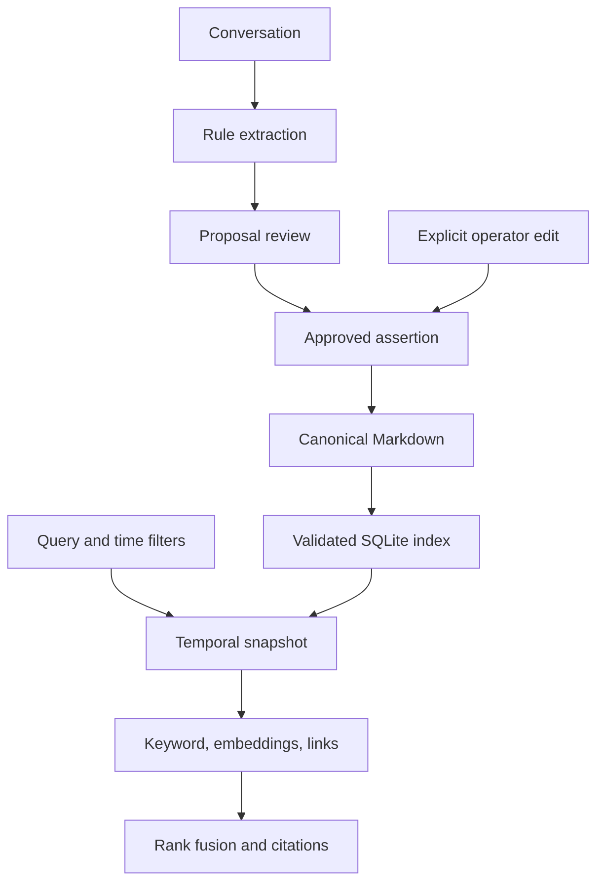

# Architecture and temporal semantics

## Data flow

The Markdown files are authoritative. SQLite provides a disposable, validated record index and a signature of the files it was built from. It holds no full-text index of its own: keyword search builds one per query over the time-filtered snapshot (see Retrieval). API and MCP requests open a store per request but share one embedding model and one vector cache per process; direct Python instances can be reused. The index file is created readable by its owner only, like the records.

A missing memory directory is created, readable by its owner only, by `MemoryStore(root)` in Python (the default `create=True`) and by the CLI's `init`, `demo` and `git-init`. Every other CLI command except `serve` and `mcp` fails with `MissingMemoryDirectoryError`, a `StoreIntegrityError`: `agent`, `checkpoint` and `git-log` check for the folder first, and the rest open the store with `create=False`. `serve` and `mcp` start anyway: the HTTP API and the MCP server open the store with `create=False` for each request, and until the folder is back each memory request or tool call gets that error (HTTP 503, an MCP tool error). A folder that was moved or renamed is therefore reported instead of being replaced by an empty one at the old path. `memory/`, `.memoryos/` and `proposals/` are created without their parent folders, so a root that disappears while a store opens is reported, even with `create=True`, rather than recreated.

### Keeping the index honest without rereading everything

The index stores, for every Markdown file, its size, modification time and SHA-256. Opening the store and every write first compare that signature with the folder:

1. Stat every `*.md` file under `memory/` (one `os.scandir` pass; no file is read). Names starting with a dot are skipped: editors create lock and swap files that way (Emacs's lock file is a dangling `.#name.md` link), and hidden folders belong to other tools.
2. If the set of paths, or any size or modification time, differs, validate every record and rebuild the index.
3. A file modified within three seconds of its last verification is also hashed, because a coarse filesystem clock could give a later edit the same timestamp. This is the "racily clean" rule Git uses for its own index.
4. Otherwise the index is trusted. This common case is answered in a read transaction, so opening a store does not wait for a writer (such as a Git checkpoint) that holds the write lock.

A write then validates only the history it touches. Every validation rule (one successor per record, corrections keep entity, attribute and start, no duplicate effective start, no correction recorded before its target) is local to one entity/attribute pair as spelled, except ID uniqueness, which is a primary-key lookup; a new assertion (one that corrects or retracts nothing) is also checked against records in the other spellings of its names (see Two time axes below). The write holds SQLite `BEGIN IMMEDIATE` across the check, the atomic file replacement and the index insert, so independent processes serialize. An independent-process test exercises duplicate-write conflicts.

Any failure inside the write transaction, including the `COMMIT` itself, removes the Markdown file written in it. A process killed after the file replacement but before commit leaves a valid record that the index does not list; the next check sees the extra path and indexes it, so the write took effect. A rebuild is all-or-nothing: a malformed record makes the operation fail and leaves the previous index untouched until the file is repaired. Error messages name files relative to the memory directory, so the HTTP API never discloses where the store lives. A JSON syntax error in a record gives its line and column in the file as an editor counts them (CRLF, CR and LF each end a line, and a byte-order mark is not a character), not within the JSON block. Problems found in the files on disk raise `StoreIntegrityError`, which the API reports as 503 rather than blaming the request. A symbolic-link Markdown file or folder under `memory/` (other than a dot-named one) is rejected, and so is a link in place of the index or its log files.

Notes without a record marker line are never decoded as records, so their encoding does not matter. A file that the index knew as a record but that no longer holds one (emptied, truncated, or with its marker line changed) is reported instead of being treated as a note, so a value it had superseded cannot silently come back. A brand-new index has no such memory, so this check applies from the second open onward. Records are UTF-8 and may start with a byte-order mark and use Windows or classic Mac line endings; a record saved in another encoding, including UTF-16 and UTF-32, is reported rather than read as a note. File names under `memory/` must be valid UTF-8; another name is reported, naming the file.

The index has a schema version (currently 3). An older index is upgraded in place and its file signatures are dropped, so the first open reads every file again under the current parsing rules (0.2.0 and 0.2.1 read a record behind a byte-order mark or with classic Mac line endings as a note); an index written by a newer release is refused with a message to delete `.memoryos/`, because older code cannot know what a newer index assumes. An index first created by 0.2.0 keeps that release's full-text table, unused and no longer updated, so 0.2.0 processes still running do not fail; delete `.memoryos/` and run `memoryos --root <memory directory> reindex` to remove it. A damaged index file (SQLite reports it is not a database, or a damaged page) stops the operation with a message that says to stop other programs using the memory directory and then run reindex with `--root` set to it (`memoryos --root <memory directory> reindex`; without `--root`, reindex works on the default directory instead). Only that command (or `MemoryStore(root, repair_index=True)`), which first checks every page and the column names of the index tables, renames it to `index.sqlite3.corrupt-<time>` and rebuilds, because renaming database files under other running processes is unsafe. A damaged column name, or a stored record that no longer decodes, shows up only when a query reads it; it is reported as index damage with the same repair hint (HTTP 503). `memoryos reindex` sets an index with a damaged column name aside and rebuilds a damaged record in place; a normal open pays for neither check. Locked, read-only or full disks are never mistaken for damage. Two processes opening a new store at the same moment retry briefly instead of failing on the schema lock. Files and their folders, including new topic folders, are flushed with `fsync` after each write, matching SQLite's default durability. The index file is readable by its owner only.

Reads parse each indexed record once per store instance and reuse it while its stored payload is unchanged; records are immutable, including their tags and links. Writes made within the same few milliseconds are given strictly increasing recorded times. Snapshots push the knowledge cutoff and optional entity filter into SQL. External text editors do not take the database lock, so do not edit concurrently with application writes.

## Two time axes

| Field or parameter | Meaning |
| --- | --- |
| `valid_from` | First instant an assertion applies to the world |
| `valid_to` | Optional exclusive end; later state changes can shorten it |
| `recorded_at` | When the assertion or correction became known |
| `as_of` | Effective instant requested by the query |
| `known_at` | Latest recorded knowledge available to the query |

Query times are instants. A date alone means 00:00 UTC at the start of that day, not the whole day and not local time, so as a `known_at` it leaves out facts recorded later that day. The CLI help, the HTTP API documentation, the MCP server's instructions and date parameter descriptions, the agent's prompt and the Python docstrings say so, and the MCP `search` and `memory_history` tools also return the UTC instants they used.

For each entity/attribute pair (names compared by `name_key`, so every spelling of a name shares one timeline):

1. Keep only audit records recorded at or before `known_at`.
2. Hide records superseded by visible revisions, retaining them in the audit store.
3. Sort remaining assertions, including tombstones, by effective start. Records in different spellings of the names can share a start (in stores written before 0.3.1, by a 0.3.0 process, or by hand). Only one of them is then used: the one whose original record (itself, if it was never corrected or retracted) has the latest `recorded_at`, or on equal times the greatest ID in string order. The others are left out of the timeline but stay in the audit store, so correcting or retracting any of them never changes which one is shown.
4. Bound each interval by its explicit end and the next assertion's start.
5. Return non-tombstones satisfying `valid_from <= as_of < valid_to`.

A missing end is open-ended. An explicit expiration leaves a gap until the next assertion; an earlier state does not reappear. An approved restatement inside such an interval keeps the same explicit end. A tombstone keeps its interval boundary and prevents resurrection of an earlier state. A later correction restores a tombstoned assertion when desired. Corrections retain the original entity, attribute, and start; they must not predate the record they revise. Within one spelling of the names, duplicate effective starts without a supersession relation are rejected, on write and on load. A new assertion (one that corrects or retracts nothing) is also refused when a record in another spelling of the same names already holds its start, tombstones included. Loading does not apply this cross-spelling check, so a store in which two spellings already share a start still opens, and either record can still be corrected or retracted (see step 3).

This model represents a single-valued changing attribute, not arbitrary overlapping event intervals. Snapshot `valid_to` is derived and may differ from a record fetched by audit ID.

### Names

Entity and attribute names are compared by `name_key` (in `models.py`): NFKC normalization, then Unicode default case folding, then `i` followed by one or more combining dots above (U+0307) becomes `i` (so the Turkish dotted `İ` matches `I`; the dotless `ı` stays a separate letter), then NFKC again (case folding can decompose a letter), and finally runs of whitespace (as Python's `str.split` finds them) collapsed to one space, none at either end. Accents count. Records keep the spelling they were written with: the key is never stored, so the record format, the index schema and older processes reading the same folder are unchanged. History, snapshots, audit trails, search, links and extraction all match by key. The index stores names as written, so a lookup first finds the stored spellings of both names and then queries `entity IN (...) AND attribute IN (...)` on the temporal index. Each store keeps the entity spellings per key, adds those it writes itself, and reads them again after another connection commits (SQLite's `data_version` reports this), after its own index rebuild, or after a failed write; attribute spellings are read from the index on every lookup.

`add` files a new record under a spelling memory already uses, inside its write transaction: a pair stored exactly as given is kept; otherwise the record takes both names of the latest recorded matching record that is still in effect (neither a retraction nor revised since), else of the latest recorded match. If the entity is stored but none of its records has the attribute, a stored entity spelling as given is kept, else the entity's spelling is taken the same way from all of that entity's records, whatever their attribute, and the attribute keeps its spelling. A new entity keeps its spelling, and so does its attribute, even if another entity uses that attribute in another spelling. Of records recorded at the same instant, the one with the greater ID counts as the later. Loading still applies the per-spelling rules, so every store an older release wrote opens unchanged. Because names that differ only in letter case, compatibility form or extra spaces are one name, such stores can show fewer current values than before: a value that only looked current because it was filed under another spelling now ends where the other spelling's next record starts, even if that record is a retraction made to tidy up the pair, and of records that share a start only one is shown (step 3 above). Correct the record shown to change it. Case folding follows the Unicode version of the running Python, so a few recently added characters fold differently on older versions.

## Retrieval

Every channel sees the resolved snapshot. Keyword search builds a temporary SQLite FTS5 table over eligible facts so excluded future facts cannot affect BM25 statistics. The default embedding channel uses deterministic token hashing with a small declared alias map. A Sentence Transformers model can replace it through configuration. Document vectors are cached by embedder name and the exact embedded text, so an edited record or a different model can never reuse a stale vector; mostly-zero vectors are stored sparsely and others as arrays of doubles. A retriever caches up to 50,000 vectors, and a cache can be shared by several retrievers. Text is NFKC-normalized and case-folded before tokenizing, and combining marks stay inside words; the keyword index also folds accents. Common English question words are dropped from keyword and lexical queries unless the query names an entity whose name contains them; keyword search decides this after folding accents, so "à" counts as "a", and at most 64 distinct keyword terms are used. Relationship search seeds entities whose words all appear in the query (when several names share their words, as C, C# and C++ do, the one written out in the query wins; quotes, brackets, sentence punctuation and a possessive "'s" around it are allowed) and expands them through explicit `links` for one hop.

Hybrid retrieval uses reciprocal rank fusion with denominator `60 + rank`, and a 0.7 weight on the graph channel. Ranks are competition ranks: equal raw scores share a rank, so a tie can never be broken by the random order of fact IDs before fusion. Raw channel scores and the fused rank are returned for inspection. It does not generate answers, infer missing facts, or turn confidence values into truth guarantees. The record ID, source, evidence, interval, and Markdown path allow the calling assistant to cite evidence.

## Trust boundaries and limits

Only structured canonical blocks are indexed. Ordinary prose notes do not become facts accidentally. Extraction never executes text and never approves its own updates. The CLI/API also provide direct operator writes for intentionally supplied facts. MCP exposes read tools only. Memory text is untrusted data, including when it contains instructions or protocol-looking strings.

Topic paths are confined to the memory tree; symlinked records, folders and index files are rejected. The HTTP API only answers requests addressed to localhost unless other host names are configured. FTS query tokens are quoted, and SQL uses parameters. Approval files use separate serialization and a POSIX lock. This is a local application, not a hardened hostile multi-user filesystem. Backups, filesystem permissions, and encryption remain the operator's responsibility.

There is no cross-file transaction combining a newly written fact and its proposal approval status. Approving again after an interruption recognizes the fact that was already written (same value, date, source, evidence, confidence and topic, not already claimed by an approved proposal that states the same thing) and marks the proposal approved. Rejecting such a proposal is refused while its fact is unrevised and no other pending proposal stating the same line (its topic in another letter case) can claim it, because the fact would stay; approve it to finish, then retract the fact if it is wrong. Once the fact has been retracted or corrected, the proposal can be rejected. Git checkpoints hold the proposal lock and the store's write lock while staging, so a commit cannot interleave an in-flight approval between its fact write and status save; an interrupted approval can still leave a fact with a pending proposal, which retry recovery handles. Git is explicit opt-in and does not erase retracted evidence.

## Modules

| Module | Responsibility |
| --- | --- |
| `models.py` | Fact validation, UTC timestamps, name comparison (`name_key`), safe topic paths |
| `store.py` | Markdown records, change detection, SQLite index, temporal resolution, revisions |
| `extraction.py` | Rule extraction, proposals, human approval |
| `embeddings.py` | Offline hashing and optional learned provider |
| `retrieval.py` | Snapshot filtering, ranking, links, citations |
| `agent.py` | Optional SDK-managed model/tool execution with read-only memory tools |
| `git_history.py` | Local checkpoint isolation |
| `cli.py` | JSON command-line interface |
| `api.py` | Optional FastAPI service |
| `mcp_server.py` | Optional SDK-managed read-only stdio tools |

## Optional agent execution

`agent.py` delegates each question to the Claude Agent SDK's `query`. It consumes
SDK messages and returns the terminal answer; it does not schedule model calls or
dispatch tools itself. The SDK starts the existing local MCP server using the same
Python interpreter. Only search, fetch, and memory_history are exposed. The agent
uses a temporary working directory, explicit tool permissions, no inherited settings
or MCP servers, and no conversation persistence. AnyIO cancellation lets the SDK
clean up subprocesses when the timeout expires. Provider errors are sanitized.

This integration reads memory and can update the disposable index during reads.
It cannot approve or write facts through its tools. The question and retrieved data
are sent to the configured model provider. Dates are model instructions; the MCP
server remains a read-only audit interface, not a date-based authorization boundary.
