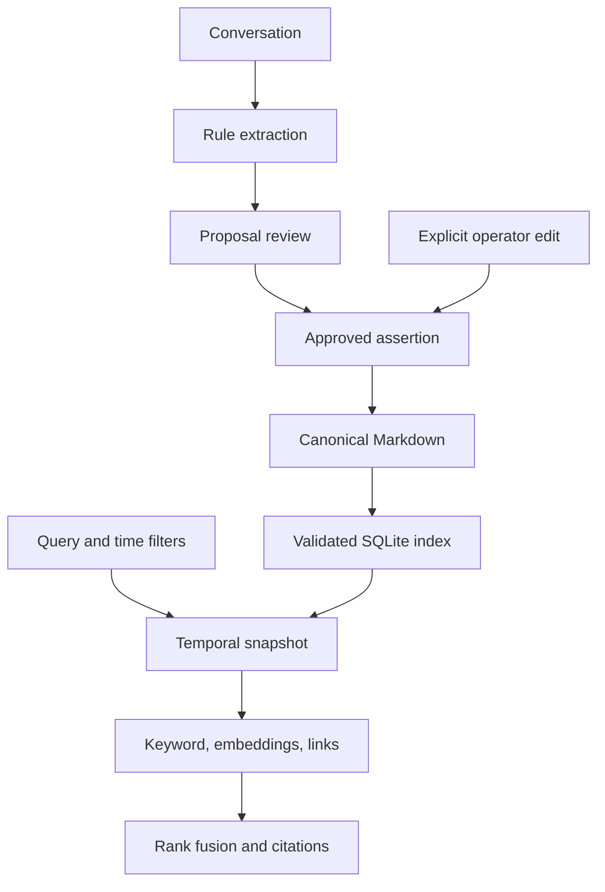

# Architecture and temporal semantics

## Data flow

The Markdown files are authoritative. SQLite provides a disposable, validated record index and a signature of the files it was built from. It holds no full-text index: keyword search builds one per query over the time-filtered snapshot (see Retrieval). API and MCP requests create a store per request; direct Python instances can be reused.

### Keeping the index honest without rereading everything

The index stores, for every Markdown file, its size, modification time and SHA-256. Opening the store and every write first compare that signature with the folder:

1. Stat every `*.md` file under `memory/` (one `os.scandir` pass; no file is read).
2. If the set of paths, or any size or modification time, differs, validate every record and rebuild the index.
3. A file modified within three seconds of its last verification is also hashed, because a coarse filesystem clock could give a later edit the same timestamp. This is the "racily clean" rule Git uses for its own index.
4. Otherwise the index is trusted.

A write then validates only the history it touches. Every validation rule (one successor per record, corrections keep entity, attribute and start, no duplicate effective start, no correction recorded before its target) is local to one entity/attribute pair, except ID uniqueness, which is a primary-key lookup. The write holds SQLite `BEGIN IMMEDIATE` across the check, the atomic file replacement and the index insert, so independent processes serialize. An independent-process test exercises duplicate-write conflicts.

A process crash after file replacement but before commit leaves a file that the index does not list; the next check sees the extra path and rebuilds. A rebuild is all-or-nothing: a malformed record makes the operation fail and leaves the previous index untouched until the file is repaired. A symbolic link anywhere under `memory/` is rejected.

Reads parse each indexed record once per process and reuse it while its stored payload is unchanged. Snapshots push the knowledge cutoff and optional entity filter into SQL. External text editors do not take the database lock, so do not edit concurrently with application writes.

## Two time axes

| Field or parameter | Meaning |
| --- | --- |
| `valid_from` | First instant an assertion applies to the world |
| `valid_to` | Optional exclusive end; later state changes can shorten it |
| `recorded_at` | When the assertion or correction became known |
| `as_of` | Effective instant requested by the query |
| `known_at` | Latest recorded knowledge available to the query |

For each entity/attribute pair:

1. Keep only audit records recorded at or before `known_at`.
2. Hide records superseded by visible revisions, retaining them in the audit store.
3. Sort remaining assertions, including tombstones, by effective start.
4. Bound each interval by its explicit end and the next assertion's start.
5. Return non-tombstones satisfying `valid_from <= as_of < valid_to`.

A missing end is open-ended. An explicit expiration leaves a gap until the next assertion; an earlier state does not reappear. A tombstone keeps its interval boundary and prevents resurrection of an earlier state. A later correction restores a tombstoned assertion when desired. Corrections retain the original entity, attribute, and start; they must not predate the record they revise. Duplicate effective starts without a supersession relation are rejected.

This model represents a single-valued changing attribute, not arbitrary overlapping event intervals. Normalize entity and attribute names consistently: identity is case-sensitive in the store. Retrieval's optional entity filter is case-insensitive for convenience. Snapshot `valid_to` is derived and may differ from a record fetched by audit ID.

## Retrieval

Every channel sees the resolved snapshot. Keyword search builds a temporary SQLite FTS5 table over eligible facts so excluded future facts cannot affect BM25 statistics. The default embedding channel uses deterministic token hashing with a small declared alias map. A Sentence Transformers model can replace it through configuration. A retriever caches each record's document vector (stored sparsely, with its norm) by fact ID; records are immutable and the derived end of an interval is not embedded, so the ID identifies the vector. Relationship search expands exact token-matched entity names through explicit `links` for one hop.

Hybrid retrieval uses reciprocal rank fusion with denominator `60 + rank`, and a 0.7 weight on the graph channel. Raw channel scores and the fused rank are returned for inspection. It does not generate answers, infer missing facts, or turn confidence values into truth guarantees. The record ID, source, evidence, interval, and Markdown path allow the calling assistant to cite evidence.

## Trust boundaries and limits

Only structured canonical blocks are indexed. Ordinary prose notes do not become facts accidentally. Extraction never executes text and never approves its own updates. The CLI/API also provide direct operator writes for intentionally supplied facts. MCP exposes read tools only. Memory text is untrusted data, including when it contains instructions or protocol-looking strings.

Topic paths are confined to the memory tree; symlink record/index paths are rejected. FTS query tokens are quoted, and SQL uses parameters. Approval files use separate serialization and a POSIX lock. This is a local application, not a hardened hostile multi-user filesystem. Backups, filesystem permissions, and encryption remain the operator's responsibility.

There is no cross-file transaction combining a newly written fact and its proposal approval status. Successful repeated approval is idempotent, but a crash between those writes may require reconciliation. Git is explicit opt-in and does not erase retracted evidence.

## Modules

| Module | Responsibility |
| --- | --- |
| `models.py` | Fact validation, UTC timestamps, safe topic paths |
| `store.py` | Markdown records, change detection, SQLite index, temporal resolution, revisions |
| `extraction.py` | Rule extraction, proposals, human approval |
| `embeddings.py` | Offline hashing and optional learned provider |
| `retrieval.py` | Snapshot filtering, ranking, links, citations |
| `git_history.py` | Local checkpoint isolation |
| `cli.py` | JSON command-line interface |
| `api.py` | Optional FastAPI service |
| `mcp_server.py` | Optional SDK-managed read-only stdio tools |
